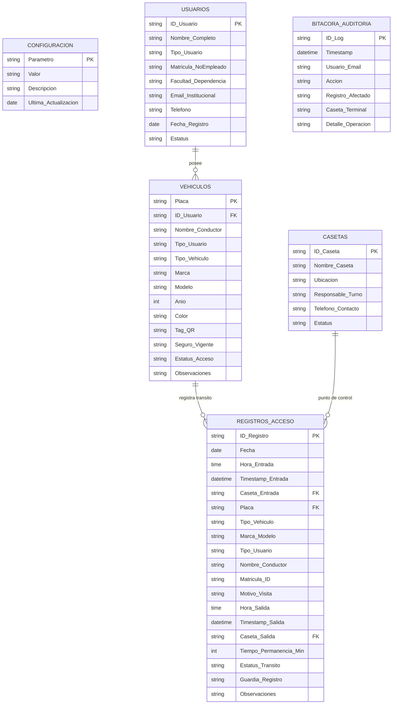

# Diccionario de Datos y Modelo de Tablas
## Sistema de Control de Acceso Vehicular - UAT Campus CUTM Sur
**Plataforma de Base de Datos:** Google Sheets / Microsoft Excel (.xlsx)

---

### 1. Arquitectura del Modelo de Datos
El sistema utiliza una arquitectura relacional normalizada implementada sobre Google Sheets como backend persistente, consumida directamente por la aplicación móvil/web **Google AppSheet** y sincronizada con la API REST de **Google Apps Script**.

---

### 2. Especificación Detallada de Campos

#### 2.1. Tabla: `Casetas`
Define los puntos físicos de control de acceso vehicular en el campus CUTM Sur.

| Columna | Tipo AppSheet | Tipo Sheets | Requerido | Descripción / Regla de Validación |
| :--- | :--- | :--- | :---: | :--- |
| `ID_Caseta` | Text (Key) | String | Sí | Identificador único (`CAS-01`, `CAS-02`, `CAS-03`). |
| `Nombre_Caseta` | Text | String | Sí | Nombre descriptivo del acceso. |
| `Ubicacion` | Text | String | Sí | Dirección o referencia cardinal en el campus. |
| `Responsable_Turno` | Text | String | Sí | Nombre del oficial o guardia en turno. |
| `Telefono_Contacto` | Phone | String | No | Extensión o teléfono de intercomunicación. |
| `Estatus` | Enum | String | Sí | `Activa`, `Mantenimiento`, `Cerrada`. |

#### 2.2. Tabla: `Usuarios`
Directorio de personas autorizadas y visitantes de la UAT.

| Columna | Tipo AppSheet | Tipo Sheets | Requerido | Descripción / Regla de Validación |
| :--- | :--- | :--- | :---: | :--- |
| `ID_Usuario` | Text (Key) | String | Sí | Identificador alfanumérico (`USR-001`, `USR-002`, ...). |
| `Nombre_Completo` | Text | String | Sí | Nombre(s) y apellidos del usuario. |
| `Tipo_Usuario` | Enum | String | Sí | `Estudiante`, `Docente`, `Administrativo`, `Visitante`, `Plataforma (DiDi / Uber)`. |
| `Matricula_NoEmpleado` | Text | String | Sí | Matrícula estudiantil, nómina docente o clave de identificación (INE para visitantes). |
| `Facultad_Dependencia` | Enum / Text | String | Sí | Unidad académica (F.I.T., FADU, FCAV) o empresa externa. |
| `Email_Institucional` | Email | String | Sí | Correo institucional `@uat.edu.mx` o correo personal de contacto. |
| `Telefono` | Phone | String | No | Número de teléfono móvil de contacto. |
| `Fecha_Registro` | Date | Date | Sí | Fecha en que fue dado de alta en el sistema. |
| `Estatus` | Enum | String | Sí | `Activo`, `Suspendido`, `Temporal`. |

#### 2.3. Tabla: `Vehiculos`
Padrón vehicular vinculado a los usuarios del campus.

| Columna | Tipo AppSheet | Tipo Sheets | Requerido | Descripción / Regla de Validación |
| :--- | :--- | :--- | :---: | :--- |
| `Placa` | Text (Key) | String | Sí | Matrícula oficial vehicular sin espacios ni guiones especiales (ej. `XHC-458-B`). |
| `ID_Usuario` | Ref (Usuarios) | String | Sí | Llave foránea que referencia al propietario en la tabla `Usuarios`. |
| `Nombre_Conductor` | Text | String | Sí | Fórmula AppSheet dereferenciada: `[ID_Usuario].[Nombre_Completo]`. |
| `Tipo_Usuario` | Enum | String | Sí | Fórmula dereferenciada: `[ID_Usuario].[Tipo_Usuario]`. |
| `Tipo_Vehiculo` | Enum | String | Sí | `Automóvil`, `Motocicleta`, `Camioneta`, `Carga`. |
| `Marca` | Text | String | Sí | Marca del vehículo (ej. Volkswagen, Nissan, Toyota). |
| `Modelo` | Text | String | Sí | Modelo comercial (ej. Jetta, Versa, RAV4). |
| `Anio` | Number | Integer | Sí | Año modelo (ej. 2022). |
| `Color` | Text | String | Sí | Color exterior distintivo. |
| `Tag_QR` | Text / Code | String | Sí | Código alfanumérico codificado en el gafete o calcomanía QR oficial UAT. |
| `Seguro_Vigente` | Enum | String | Sí | `Sí` / `No`. |
| `Estatus_Acceso` | Enum | String | Sí | `Autorizado`, `Bloqueado`, `Requiere Revisión`. |
| `Observaciones` | LongText | String | No | Notas sobre infracciones previas o cajón reservado. |

#### 2.4. Tabla: `Registros_Acceso`
Registro transaccional en tiempo real de entradas y salidas.

| Columna | Tipo AppSheet | Tipo Sheets | Requerido | Descripción / Regla de Validación |
| :--- | :--- | :--- | :---: | :--- |
| `ID_Registro` | Text (Key) | String | Sí | Clave única autogenerada con formato `REG-YYYYMMDD-###`. |
| `Fecha` | Date | Date | Sí | Fecha del movimiento (`TODAY()`). |
| `Hora_Entrada` | Time | Time | Sí | Hora exacta del registro de ingreso (`TIMENOW()`). |
| `Timestamp_Entrada` | DateTime | Timestamp | Sí | Marca temporal inmutable de entrada (`NOW()`). |
| `Caseta_Entrada` | Ref (Casetas) | String | Sí | Caseta por donde ingresó el vehículo (`CAS-01`, `CAS-02`, `CAS-03`). |
| `Placa` | Ref / Text | String | Sí | Placa del vehículo que ingresa (leída por QR o ingresada por teclado). |
| `Tipo_Vehiculo` | Enum | String | Sí | Tipo de unidad motriz. |
| `Marca_Modelo` | Text | String | No | Marca y modelo para validación visual rápida del guardia. |
| `Tipo_Usuario` | Enum | String | Sí | `Estudiante`, `Docente`, `Administrativo`, `Visitante`, `Plataforma (DiDi / Uber)`. |
| `Nombre_Conductor` | Text | String | Sí | Nombre de la persona que conduce. |
| `Matricula_ID` | Text | String | Sí | Matrícula UAT / No. Empleado o documento oficial (`INE` / `Licencia de Conducir` para DiDi/Uber/visitantes). |
| `Motivo_Visita` | Text | String | Sí | Área/Facultad destino (`F.I.T.`, `FADU`, `FCAV`, etc.) y Asunto (ej. "DiDi - Pasaje Alumno", "Proveedor"). |
| `Hora_Salida` | Time | Time | No | Hora en que el vehículo abandona las instalaciones. |
| `Timestamp_Salida` | DateTime | Timestamp | No | Marca temporal inmutable de salida. |
| `Caseta_Salida` | Ref (Casetas) | String | No | Caseta por donde egresó el vehículo. |
| `Tiempo_Permanencia_Min` | Number | Integer | No | Minutos totales de estancia dentro del campus: `ROUND((Timestamp_Salida - Timestamp_Entrada) / 60)`. |
| `Estatus_Transito` | Enum | String | Sí | `Dentro` (vehículo en instalaciones) o `Concluido` (salida registrada). |
| `Guardia_Registro` | Text | String | Sí | Correo o nombre del oficial de seguridad autenticado (`USEREMAIL()`). |
| `Observaciones` | LongText | String | No | Notas de inspección, cajón de estacionamiento utilizado, etc. |

#### 2.5. Tabla: `Bitacora_Auditoria`
Log inmutable para garantizar la trazabilidad y la norma ISO/IEC 25010 en seguridad.

| Columna | Tipo Sheets | Descripción |
| :--- | :--- | :--- |
| `ID_Log` | String (Key) | Identificador secuencial del evento de auditoría (`LOG-####`). |
| `Timestamp` | Timestamp | Fecha y milisegundo exacto de la operación. |
| `Usuario_Email` | String | Correo del usuario o guardia que ejecutó la acción. |
| `Accion` | String | Tipo de evento: `LOGIN`, `REGISTRO_ENTRADA`, `REGISTRO_SALIDA`, `ALTA_VEHICULO`, `BLOQUEO_PLACA`. |
| `Registro_Afectado` | String | ID del registro modificado o consultado. |
| `Caseta_Terminal` | String | Nombre de la caseta o dispositivo emisor. |
| `Detalle_Operacion` | String | Resumen legible de los cambios o validaciones realizadas. |
