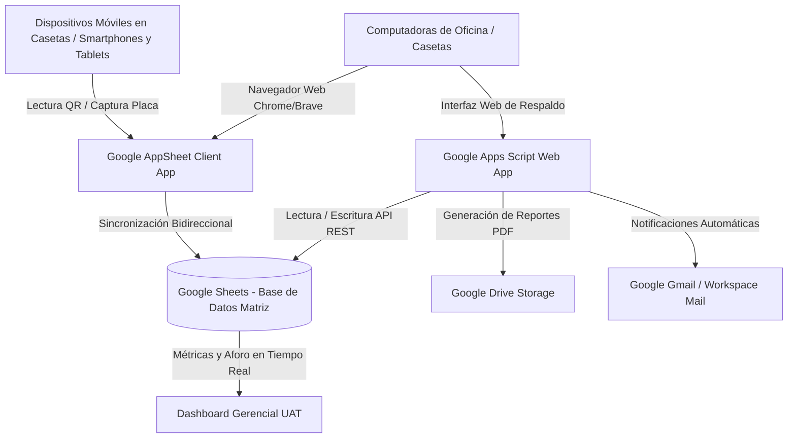
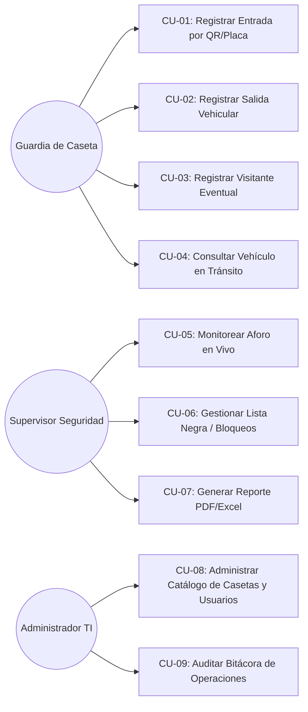
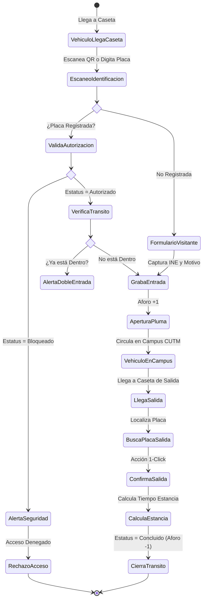
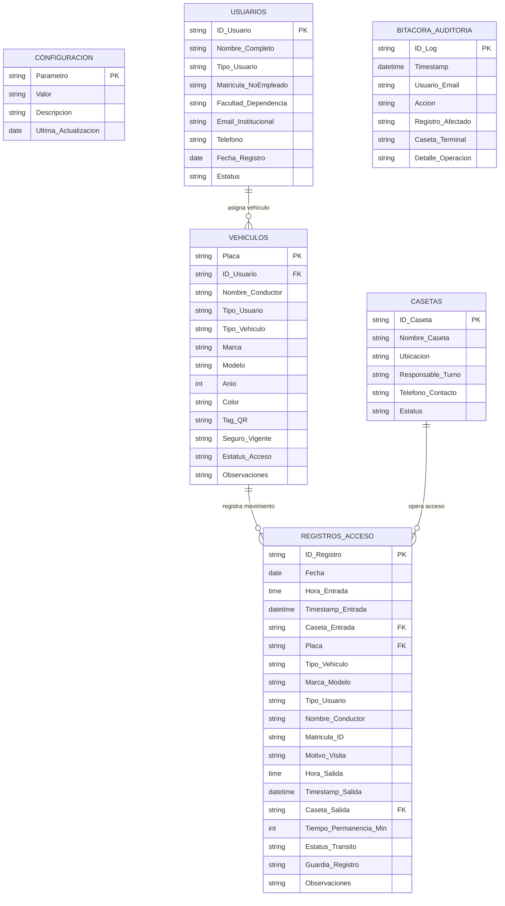

# DOCUMENTO DE ESPECIFICACIÓN DE REQUERIMIENTOS DE SOFTWARE (ERS)
## Sistema de Control de Acceso Vehicular para la UAT Campus CUTM Sur
**Estándares Aplicados:** IEEE 830-1998 / ISO/IEC/IEEE 29148:2018 / ISO/IEC 25010 (Calidad de Software)  
**Institución:** Universidad Autónoma de Tamaulipas (UAT)  
**Unidad Académica:** Facultad de Ingeniería Tampico (F.I.T.)  
**Coordinación:** Ingeniería en Sistemas Computacionales  
**Sede:** Centro Universitario Tampico Madero (CUTM Sur)  
**Versión:** 1.0 Oficial  
**Fecha:** Noviembre 2026  

---

## 1. INTRODUCCIÓN

### 1.1 Propósito
El propósito del presente documento es especificar de manera formal, completa y verificable los requerimientos funcionales y no funcionales para el diseño, desarrollo e implantación del **Sistema de Control de Acceso Vehicular** del Campus Universitario Tampico Madero Sur (CUTM Sur) de la Universidad Autónoma de Tamaulipas (UAT), utilizando la plataforma tecnológica integrada por **Google AppSheet**, **Google Apps Script** y **Google Sheets**.

Este documento está dirigido al comité evaluador del Hackatón UAT-Google, al equipo de desarrollo de software, al personal de la Coordinación de Seguridad Universitaria y a los oficiales operativos de las casetas de acceso.

### 1.2 Alcance del Producto
El sistema contempla la digitalización integral del control vehicular en los tres accesos del campus:
- **Caseta 1:** Acceso Principal Norte (Blvd. Adolfo López Mateos).
- **Caseta 2:** Acceso Poniente (Av. Universidad).
- **Caseta 3:** Acceso Este (Área Deportiva y Facultad de Ingeniería Tampico).

El sistema sustituye las bitácoras físicas de papel por una solución móvil y web en la nube que permite:
1. El empadronamiento digital de vehículos de estudiantes, docentes, personal administrativo y proveedores/visitantes.
2. La lectura rápida de placas y códigos QR mediante cámaras de dispositivos móviles (smartphones/tablets) y lectores de caseta.
3. El registro automatizado de entradas y salidas con cálculo instantáneo del tiempo de permanencia.
4. El monitoreo en tiempo real del aforo de estacionamientos y saturación del campus.
5. La detección inmediata de vehículos no autorizados, reportados o en lista negra.
6. La generación automática de reportes gerenciales en formatos Excel (.xlsx) y PDF almacenados en Google Drive.
7. Notificaciones automatizadas por correo electrónico institucional al personal que recibe visitas externas.

### 1.3 Definiciones, Acrónimos y Abreviaturas
- **CUTM Sur:** Centro Universitario Tampico Madero Sur.
- **UAT:** Universidad Autónoma de Tamaulipas.
- **F.I.T.:** Facultad de Ingeniería Tampico.
- **AppSheet:** Plataforma no-code de Google Cloud para desarrollo rápido de aplicaciones web y móviles conectadas a fuentes de datos.
- **Apps Script:** Lenguaje de scripting basado en JavaScript moderno (V8) ejecutado en la nube de Google Workspace.
- **Aforo:** Cantidad de vehículos que se encuentran simultáneamente dentro de los estacionamientos del campus.
- **LPR / OCR:** *License Plate Recognition* / *Optical Character Recognition* (Reconocimiento Óptico de Caracteres para placas vehiculares).
- **QR:** *Quick Response Code*, código bidimensional para identificación ágil en caseta.
- **RF:** Requisito Funcional.
- **RNF:** Requisito No Funcional.
- **CU:** Caso de Uso.

### 1.4 Referencias Normativas
- **IEEE Std 830-1998:** *IEEE Recommended Practice for Software Requirements Specifications*.
- **ISO/IEC/IEEE 29148:2018:** *Systems and software engineering — Life cycle processes — Requirements engineering*.
- **ISO/IEC 25010:2011:** *Systems and software engineering — Systems and software Quality Requirements and Evaluation (SQuaRE) — System and software quality models*.
- **Reglamento General de Tránsito y Estacionamiento de la Universidad Autónoma de Tamaulipas.**

---

## 2. DESCRIPCIÓN GENERAL

### 2.1 Perspectiva del Producto
El Sistema de Control de Acceso Vehicular opera como un ecosistema en la nube sobre la infraestructura de **Google Workspace**. No requiere servidores físicos locales ni licencias complejas de bases de datos relacionales tradicionales, garantizando disponibilidad 24/7, bajo costo de mantenimiento y escalabilidad nativa.

### 2.2 Clases y Características de Usuarios
1. **Guardia Operativo de Caseta:** Oficial de seguridad ubicado en las tres entradas/salidas. Posee competencias digitales básicas. Requiere una interfaz con botones grandes, escaneo de un solo toque y tiempos de respuesta menores a 3 segundos para evitar filas.
2. **Coordinador / Supervisor de Seguridad:** Personal administrativo responsable de la vigilancia del campus. Requiere consultas avanzadas, monitoreo de aforo, control de lista negra y exportación de bitácoras.
3. **Administrador del Sistema (TI / F.I.T.):** Personal de Sistemas Computacionales encargado del mantenimiento de catálogos, asignación de roles y parametrización general.
4. **Comunidad Universitaria (Estudiantes, Docentes, Administrativos):** Portadores de calcomanía o gafete QR en sus vehículos para paso ágil.
5. **Visitantes Externos:** Conductores eventuales que requieren registro de identificación y registro del motivo de visita.

### 2.3 Restricciones de Diseño e Implementación
- **Plataforma Obligatoria:** Google AppSheet, Google Apps Script y Google Sheets conforme a las bases oficiales del Hackatón.
- **Conectividad:** Operación en red Wi-Fi universitaria (Red UAT) y respaldo para conectividad celular 4G/5G en caso de intermitencia.
- **Seguridad:** Acceso restringido exclusivamente a cuentas institucionales autorizadas mediante Google OAuth 2.0.

---

## 3. REQUISITOS FUNCIONALES (RF)

Los requisitos funcionales han sido identificados, clasificados y priorizados bajo la metodología MoSCoW (*Must have, Should have, Could have, Won't have*):

| Código | Nombre del Requisito | Prioridad | Descripción / Regla de Negocio |
| :--- | :--- | :---: | :--- |
| **RF-001** | **Catálogo de Casetas** | Must | El sistema debe permitir registrar y administrar las tres casetas del campus CUTM Sur (Caseta 1 López Mateos, Caseta 2 Av. Universidad, Caseta 3 Deportes/FIT) con estatus y vigilante en turno. |
| **RF-002** | **Catálogo de Usuarios y Roles** | Must | El sistema debe registrar a los usuarios clasificándolos en: Estudiantes (con matrícula), Docentes (número de empleado), Administrativos (número de nómina), Visitantes e Conductores de Plataforma Digital (DiDi, Uber, Taxi). |
| **RF-003** | **Catálogo de Vehículos Autorizados** | Must | El sistema debe mantener el padrón vehicular con: Placa, Propietario (FK Usuario), Tipo de vehículo (Auto, Moto, Camioneta, Carga), Marca, Modelo, Color, Código QR único y Estatus (Autorizado, Bloqueado, Revisión). |
| **RF-004** | **Captura y Escaneo de Placas / QR** | Must | El sistema debe permitir registrar la entrada vehicular tanto mediante la lectura de código QR con la cámara del dispositivo móvil como por teclado manual del número de placa. |
| **RF-005** | **Autocompletado de Información Vehicular** | Must | Al ingresar o escanear una placa registrada, el sistema debe autocompletar automáticamente el nombre del conductor, tipo de usuario, vehículo y estatus de autorización. |
| **RF-006** | **Registro Automático de Fecha y Hora** | Must | El sistema debe estampar de forma inmutable la fecha (`TODAY()`) y la hora exacta (`TIMENOW()`) al registrar entradas y salidas sin intervención manual del guardia. |
| **RF-007** | **Identificación de Caseta de Operación** | Must | El sistema debe asociar de forma automática o por selección de terminal la caseta por donde se efectúa el tránsito (`CAS-01`, `CAS-02` o `CAS-03`). |
| **RF-008** | **Prevención de Doble Entrada** | Must | Si un vehículo con estatus `Dentro` intenta registrar una nueva entrada sin haber registrado previamente su salida, el sistema debe alertar al guardia y bloquear el duplicado. |
| **RF-009** | **Registro de Salida Rápida (1-Click)** | Must | El guardia debe poder buscar la placa del vehículo que se aproxima a la pluma de salida y confirmar la salida en un solo toque, cambiando el estatus a `Concluido`. |
| **RF-010** | **Cálculo Automático de Permanencia** | Must | El sistema debe calcular en tiempo real los minutos transcurridos entre la entrada y la salida (`TOTALMINUTES(Timestamp_Salida - Timestamp_Entrada)`). |
| **RF-011** | **Registro de Visitantes y Plataformas (DiDi / Uber)** | Must | El sistema debe proveer un formulario de captura rápida (10 a 15 segundos) para registrar: Nombre, Apellido, Aplicación (DiDi/Uber/Taxi/Particular), Tipo de Identificación (INE o Licencia de Conducir), Folio, Área/Facultad que visita y Asunto del ingreso. |
| **RF-023** | **Captura de Evidencia Fotográfica Móvil** | Must | La aplicación AppSheet debe permitir capturar fotografías de prueba directamente con la cámara del smartphone para documentar incidentes, golpes vehiculares o infracciones, vinculándolas al registro digital en la nube. |
| **RF-024** | **Regla de Negocio Vial: Prohibición de Rampa en Paradas de Camión** | Must | Al registrar el acceso de un DiDi o Uber, el sistema debe emitir un aviso obligatorio en pantalla: "Prohibido hacer rampa/base en paradas de autobús del campus. Tolerancia máxima de permanencia: 15 minutos", activando el monitoreo de tiempo. |
| **RF-025** | **Canal Centralizado de Alertas Digitales** | Should | El sistema debe proveer un canal digital sincronizado para notificar incidencias entre las tres casetas y el equipo de vigilancia, superando las limitaciones del radio de voz y grupos informales de mensajería. |
| **RF-012** | **Alerta de Lista Negra / Vehículos Bloqueados** | Must | Si un vehículo catalogado como `Bloqueado` es presentado en caseta, el sistema debe desplegar una alerta visual de alta prioridad (roja) y registrar un intento de violación de seguridad. |
| **RF-013** | **Monitoreo de Aforo en Tiempo Real** | Must | El sistema debe computar y mostrar en todo momento el número de vehículos dentro de las instalaciones, el cupo disponible (de 450 cajones) y el porcentaje de ocupación. |
| **RF-014** | **Alerta de Saturación de Estacionamiento** | Should | El sistema debe emitir una advertencia visual cuando el aforo supere el 85% de la capacidad máxima del campus para desviar tráfico hacia casetas con menor afluencia. |
| **RF-015** | **Consulta Avanzada por Placa** | Must | El sistema debe permitir consultar el historial completo de accesos, fechas, casetas utilizadas y tiempos de estancia de cualquier placa vehicular. |
| **RF-016** | **Consulta por Rango de Fechas** | Must | El sistema debe permitir filtrar los registros por fecha de inicio y fin para auditar periodos específicos. |
| **RF-017** | **Consulta por Acceso / Caseta** | Must | El sistema debe permitir desglosar el flujo de vehículos correspondiente a cada una de las 3 casetas. |
| **RF-018** | **Consulta por Tipo de Usuario** | Must | El sistema debe permitir segmentar el tráfico entre Estudiantes, Docentes, Administrativos y Visitantes. |
| **RF-019** | **Reporte de Vehículos Más Frecuentes y Horas Pico** | Should | El sistema debe identificar los vehículos con mayor frecuencia de ingreso y los intervalos horarios con mayor saturación (horas pico). |
| **RF-020** | **Exportación a Excel y Generación de PDF** | Must | El sistema debe permitir exportar los datos crudos a formato Microsoft Excel (.xlsx) y generar informes ejecutivos en formato PDF con diseño institucional UAT. |
| **RF-021** | **Bitácora de Auditoría Inmutable** | Must | Cada operación de alta, baja, modificación, acceso o consulta debe quedar registrada con marca temporal, correo del usuario autenticado e IP/terminal. |
| **RF-022** | **Notificación de Llegada de Visitantes** | Could | El sistema debe enviar un correo electrónico automático al personal anfitrión cuando un visitante registre su ingreso al campus. |

---

## 4. REQUISITOS NO FUNCIONALES (RNF) - ISO/IEC 25010

### 4.1 Seguridad (Security)
- **RNF-SEG-001 (Autenticación):** El acceso al sistema debe requerir autenticación obligatoria mediante cuentas corporativas Google Workspace `@uat.edu.mx`.
- **RNF-SEG-002 (Control de Acceso Basado en Roles - RBAC):** Se implementan perfiles con privilegios diferenciados:
  - *Guardia Caseta:* Registro de entradas, salidas y consulta rápida. Sin permisos para eliminar registros históricos.
  - *Supervisor de Seguridad:* Consultas globales, administración de lista negra y emisión de reportes.
  - *Administrador TI:* Configuración integral de tablas, casetas y parámetros del sistema.
- **RNF-SEG-003 (Integridad y No Repudio):** Los registros de entrada y salida no podrán ser alterados retroactivamente; cualquier corrección se registrará como un nuevo evento en la bitácora de auditoría.

### 4.2 Rendimiento y Eficiencia (Performance Efficiency)
- **RNF-REN-001 (Tiempo de Respuesta):** El tiempo de guardado y procesamiento de un registro de entrada o salida no debe exceder de **2.5 segundos** en condiciones normales de red.
- **RNF-REN-002 (Capacidad de Concurrencia):** El sistema debe soportar operaciones simultáneas desde las tres casetas sin bloqueos ni inconsistencias de datos, utilizando mecanismos de bloqueo transaccional (`LockService`).

### 4.3 Disponibilidad y Fiabilidad (Reliability)
- **RNF-DIS-001 (Disponibilidad del Servicio):** Respaldado por el SLA de Google Cloud Platform / Google Workspace (99.9% de disponibilidad anual).
- **RNF-DIS-002 (Resiliencia Fuera de Línea):** AppSheet almacena temporalmente los datos en caché local si se interrumpe la conexión a internet, sincronizándolos automáticamente tan pronto se restablece el enlace.

### 4.4 Usabilidad (Usability)
- **RNF-USA-001 (Facilidad de Aprendizaje):** Un guardia de nuevo ingreso debe ser capaz de operar con fluidez el registro de entradas y salidas tras una capacitación máxima de **15 minutos**.
- **RNF-USA-002 (Accesibilidad y Ergonomía):** Botones de acción táctiles de al menos 48x48 píxeles con alto contraste de color para visibilidad en exteriores y bajo luz solar directa.

### 4.5 Mantenibilidad (Maintainability)
- **RNF-MAN-001 (Arquitectura No-Code/Low-Code):** Permite incorporar nuevas casetas, campos o reglas de negocio sin necesidad de reescribir la base del código ni reconfigurar servidores.

---

## 5. CASOS DE USO (CU)

### 5.1 Caso de Uso Detallado: CU-01 Registrar Entrada Vehicular
- **Actor:** Guardia Operativo de Caseta.
- **Precondiciones:** El guardia ha iniciado sesión en la app y tiene seleccionada su caseta de servicio.
- **Flujo Principal:**
  1. El vehículo se detiene frente a la pluma de la caseta.
  2. El guardia enfoca la calcomanía/gafete QR con la cámara del dispositivo (o ingresa los caracteres de la placa).
  3. El sistema busca la placa en el catálogo de `Vehiculos`.
  4. El sistema valida que el vehículo se encuentre con estatus `Autorizado` y que NO tenga un registro activo de `Dentro`.
  5. El sistema autocompleta el nombre del conductor, tipo de usuario y características de la unidad.
  6. El guardia presiona "Guardar Entrada".
  7. El sistema graba el registro con `Fecha`, `Hora_Entrada`, `Caseta_Entrada` y marca `Estatus_Transito = "Dentro"`.
  8. Se actualiza el aforo general del campus y el guardia levanta la pluma de acceso.
- **Flujos Alternos:**
  - *4a. Vehículo en Lista Negra:* El sistema despliega pantalla roja "ACCESO DENEGADO - VEHÍCULO BLOQUEADO". El guardia no permite el ingreso y notifica por radio al supervisor.
  - *4b. Doble Entrada Detectada:* El sistema indica que la placa ya ingresó previamente. El guardia verifica si el vehículo salió sin registrarse o si se trata de una clonación de placa.
  - *4c. Vehículo No Empadronado:* El sistema deriva automáticamente al flujo **CU-03 (Registro de Visitante)**.
- **Postcondiciones:** El aforo aumenta en +1 y el vehículo queda registrado en estado `Dentro`.

### 5.2 Caso de Uso Detallado: CU-02 Registrar Salida Vehicular
- **Actor:** Guardia Operativo de Caseta.
- **Precondiciones:** El vehículo se encuentra físicamente en el campus con registro `Dentro`.
- **Flujo Principal:**
  1. El vehículo llega al carril de salida de cualquier caseta (Caseta 1, 2 o 3).
  2. El guardia visualiza la placa e ingresa los últimos 3 dígitos o la selecciona de la lista "Vehículos en Campus".
  3. El sistema muestra la ficha del vehículo y la hora en que ingresó.
  4. El guardia presiona el botón de acción rápida **"Registrar Salida"**.
  5. El sistema registra `Timestamp_Salida`, `Caseta_Salida`, calcula el `Tiempo_Permanencia_Min` y cambia `Estatus_Transito` a `"Concluido"`.
  6. El aforo se descuenta en -1 y se abre la pluma de egreso.
- **Postcondiciones:** El registro de tránsito queda cerrado y archivado en el histórico.

---

## 6. DIAGRAMAS DEL SISTEMA

### 6.1 Diagrama de Actividades: Flujo Integral de Control de Tránsito

### 6.2 Diagrama Entidad-Relación (Modelo Relacional de Datos)

---

## 7. MATRIZ DE TRAZABILIDAD DE REQUISITOS (RTM)

| ID Requisito | Caso de Uso | Componente Tecnológico | Criterio de Verificación | Estado |
| :---: | :---: | :--- | :--- | :---: |
| **RF-001** | CU-08 | Google Sheets (`Casetas`) / AppSheet Ref | Las 3 casetas están dadas de alta y seleccionables | Verificado |
| **RF-002** | CU-08 | Google Sheets (`Usuarios`) / AppSheet Enum | Clasificación por Estudiante, Docente, Admin, Visita | Verificado |
| **RF-003** | CU-08 | Google Sheets (`Vehiculos`) / AppSheet Table | Padrón vehicular con placa como clave única | Verificado |
| **RF-004** | CU-01 | AppSheet Scanner (Cámara) + Input Form | Lectura de QR en < 1 segundo o captura manual | Verificado |
| **RF-005** | CU-01 | AppSheet Dereference Formulas | Autocompleta datos del propietario al digitar placa | Verificado |
| **RF-006** | CU-01/02 | AppSheet `TODAY()`, `TIMENOW()`, `NOW()` | Marcas de tiempo inmutables generadas en servidor | Verificado |
| **RF-007** | CU-01/02 | AppSheet UserSettings / Dropdown Caseta | Identifica Caseta 1, 2 o 3 en cada movimiento | Verificado |
| **RF-008** | CU-01 | Apps Script / AppSheet Valid_If | Bloquea entrada si el vehículo ya está `Dentro` | Verificado |
| **RF-009** | CU-02 | AppSheet Action "Salida Rápida" | Botón 1-click en vista deck de vehículos dentro | Verificado |
| **RF-010** | CU-02 | Apps Script / AppSheet Formula `TOTALMINUTES` | Calcula tiempo de estancia exacto en minutos | Verificado |
| **RF-011** | CU-03 | AppSheet Form "Registro Visitante" | Captura obligatoria de INE y motivo de ingreso | Verificado |
| **RF-012** | CU-06 | AppSheet Format Rules & Apps Script Lock | Alerta visual roja y rechazo a placas bloqueadas | Verificado |
| **RF-013** | CU-05 | AppSheet Dashboard / Sheets Formulas | Medidor de aforo y cajones libres en tiempo real | Verificado |
| **RF-014** | CU-05 | Google Sheets Conditional / Apps Script Alert | Alerta visual y por correo al superar 85% de aforo | Verificado |
| **RF-015** | CU-04 | AppSheet Search & Apps Script API | Historial filtrable por número de placa | Verificado |
| **RF-016** | CU-07 | AppSheet Interactive Slices | Filtro de auditoría por rango de fechas | Verificado |
| **RF-017** | CU-07 | AppSheet Group By Caseta | Reporte segregado por cada acceso | Verificado |
| **RF-018** | CU-07 | AppSheet Group By Tipo Usuario | Métricas por estudiantes, docentes y visitantes | Verificado |
| **RF-019** | CU-07 | Apps Script Analytics & Sheets Dashboard | Gráficos de horas pico y usuarios frecuentes | Verificado |
| **RF-020** | CU-07 | Google Sheets Export + Apps Script PDF Gen | Exportación nativa a .xlsx y PDF oficial en Drive | Verificado |
| **RF-021** | CU-09 | Google Sheets (`Bitacora_Auditoria`) | Log inmutable con usuario, timestamp y detalle | Verificado |
| **RF-022** | CU-01 | Google Apps Script `MailApp.sendEmail` | Correo automático a anfitrión de visitante | Verificado |
