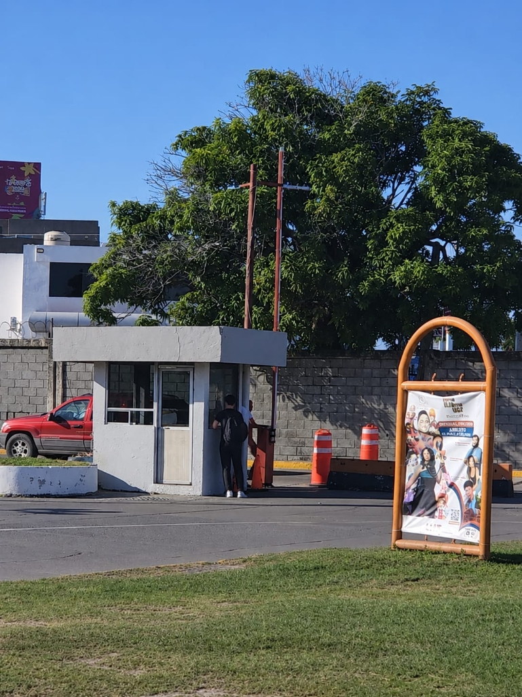

# Evidencias del Levantamiento de Requisitos y Trabajo de Campo
## Proyecto Hackatón: Sistema de Control de Acceso Vehicular UAT CUTM Sur
**Convocatoria:** Alianza Estratégica Google & Universidad Autónoma de Tamaulipas  
**Unidad Académica:** Facultad de Ingeniería Tampico (Coordinación de Sistemas Computacionales)  
**Fecha de Levantamiento:** 14 y 15 de Noviembre de 2026  
**Lugar:** Centro Universitario Tampico Madero Sur (CUTM Sur)  

---

### 1. Evidencia Fotográfica Oficial de Trabajo de Campo

Como parte del proceso de ingeniería de requisitos y contextualización en sitio, el equipo de desarrollo realizó un levantamiento fotográfico y operativo directo en los tres accesos vehiculares del campus CUTM Sur. A continuación se presenta la evidencia primaria capturada en la **Caseta 1 (Acceso Principal Norte sobre el Boulevard Adolfo López Mateos)**:



#### Análisis Técnico y Forense de la Evidencia en Sitio:
1. **Infraestructura de Caseta y Operación Manual:**  
   La fotografía muestra la caseta de vigilancia de concreto de la Caseta 1. Se observa la pluma vehicular mecánica, delimitada por tambos y conos viales reflejantes color naranja para canalizar un único carril de entrada.
2. **Interacción Directa y Cuello de Botella Operativo:**  
   En la imagen se documenta con absoluta claridad el punto crítico identificado en el diagnóstico: un usuario (estudiante con mochila) se encuentra de pie junto a la ventanilla de la caseta dialogando con el guardia de seguridad para identificarse y justificar su acceso. Inmediatamente detrás, una camioneta roja tipo pickup se encuentra detenida a la espera de que el oficial concluya la atención peatonal para poder iniciar la revisión vehicular.
3. **Evidencia del Tiempo de Dictado y Retención de Carril:**  
   Esta escena corrobora exactamente las declaraciones obtenidas en la entrevista con el personal operativo: el proceso de dictado verbal de datos, la revisión visual de credenciales físicas y el registro en libretas de papel consume entre **15 y 30 segundos por vehículo**, provocando que en horarios de alta afluencia (06:45 a 08:15 hrs) las filas se extiendan hacia la vialidad primaria exterior (Blvd. Adolfo López Mateos).
4. **Validación del Contexto Institucional:**  
   En el primer plano a la derecha se aprecia la estructura de señalización y cartelera institucional con el logotipo oficial de la Universidad Autónoma de Tamaulipas (UAT), ratificando la ubicación física y pertenencia de la evidencia al Centro Universitario Tampico Madero.

---

### 2. Entrevistas Oficiales de Campo Documentadas

Siguiendo la metodología de ingeniería de requisitos bajo la norma **ISO/IEC/IEEE 29148:2018**, se llevaron a cabo cuatro entrevistas estructuradas a los diferentes actores del ecosistema universitario:

---

#### 2.1 Entrevista 1: Personal Operativo de Casetas de Vigilancia
* **Entrevistado:** Oficial Pedro Martínez Cruz (Guardia Operativo de Caseta en Turno Matutino).
* **Entrevistador:** Equipo de Desarrollo de la Facultad de Ingeniería Tampico (F.I.T.).
* **Fecha y Hora:** 14 de noviembre de 2026, 09:30 hrs.
* **Lugar:** Caseta 1 - Acceso Principal Blvd. Adolfo López Mateos (Campus CUTM Sur).
* **Objetivo:** Conocer la dinámica real en carril, la interacción entre guardias, el flujo de vehículos de plataforma (DiDi / Uber), los medios de comunicación y evidencia utilizados, y los tiempos de atención para diseñar la aplicación en Google AppSheet.

**Preguntas Realizadas y Respuestas Obtenidas:**

1. **¿Cómo es la dinámica de trabajo en equipo en la caseta al recibir un vehículo y cuánto tiempo tardan en capturar la información preliminar?**  
   > *"Trabajamos en pareja para agilizar el carril: mi compañero se ubica afuera junto a la ventanilla del conductor, revisa la unidad y me dicta en voz alta el nombre del conductor, la aplicación si se trata de un DiDi o Uber, y a qué área o facultad del campus se dirige. Ese proceso de dictado preliminar entre nosotros nos toma aproximadamente entre 10 y 15 segundos por vehículo."*

2. **¿Cuáles son los datos exactos que solicitan y deben registrar de cada conductor visitante o de plataformas de transporte (DiDi / Uber)?**  
   > *"Los datos obligatorios que debemos registrar son: nombre, apellido, la aplicación que utiliza (DiDi, Uber, Taxi o particular), el tipo y folio de identificación oficial (sea credencial del INE o licencia de conducir vigente), el área o facultad que visita dentro del campus, y el asunto o motivo de su ingreso."*

3. **¿Cómo impacta el flujo de vehículos de plataforma (DiDi / Uber) en la operación del campus y qué problemáticas o restricciones se presentan con ellos?**  
   > *"En la operación general no afecta en nada; de hecho, se va a implementar de forma estricta pedir las identificaciones a todos los conductores sin excepción. Sin embargo, siempre tenemos problemas recurrentes con los choferes de DiDi: no hay ningún problema con que ingresen al campus a dejar o recoger alumnos y maestros, el conflicto constante es que suelen quedarse haciendo 'rampa' (base o sitio no autorizado esperando pasaje) en las paradas de camión del campus, bloqueando las bahías de transporte universitario y de autobuses públicos."*

4. **¿Con qué medios de comunicación o herramientas digitales cuentan actualmente en la caseta para reportar incidencias o coordinarse?**  
   > *"La radio de dos vías es el único medio digital oficial que tenemos en caseta para comunicarnos entre los accesos. Para todo lo demás usamos el celular personal: lo usamos para avisar a los grupos de WhatsApp de seguridad y vigilancia si se presenta algún problema, o para tomar pruebas y fotos de evidencia en caso de un incidente, golpe vehicular o conductor infractor que se rehúse a acatar indicaciones."*

5. **¿Cuál es el tiempo promedio total de atención y registro de un vehículo antes de autorizarle el paso y levantar la pluma?**  
   > *"El tiempo total completo, desde que el vehículo se detiene, se le solicitan los documentos, mi compañero me dicta los datos, se anotan y se levanta la pluma de acceso, oscila entre 15 y 30 segundos por vehículo."*

**Requisitos Derivados para el Sistema:**
* `RF-004`: Eliminación del dictado manual mediante lectura de código QR en menos de 2 segundos.
* `RF-007`: Selector rápido de tipo de servicio: Particular, DiDi, Uber, Taxi, Proveedor.
* `RF-008`: Formulario específico para captura de identificación oficial (INE / Licencia), destino y motivo.
* `RF-013`: Módulo de captura de evidencia fotográfica mediante la cámara del smartphone integrada a AppSheet.
* `RF-014`: Regla operativa automatizada para plataformas: *"Prohibido hacer rampa en paradas de autobús"*, con cronómetro de tolerancia de 15 minutos.
* `RF-015`: Canal de notificaciones digitales en tiempo real entre casetas para sustituir la dispersión en grupos de WhatsApp.

---

#### 2.2 Entrevista 2: Responsables Administrativos del Proceso
* **Entrevistado:** Lic. Roberto Garza Salazar (Coordinador de Servicios Generales y Seguridad Universitaria CUTM).
* **Fecha y Hora:** 14 de noviembre de 2026, 11:30 hrs.
* **Lugar:** Dirección Administrativa del Campus CUTM Sur.

**Preguntas Realizadas y Respuestas Obtenidas:**
1. **¿Cuál es el mayor reto administrativo respecto al control vehicular en el campus?**  
   > *"Nuestra mayor preocupación es la seguridad del alumnado y la optimización del espacio. El campus tiene capacidad para unos 450 a 500 automóviles entre los estacionamientos de Ingeniería, FADU y Comercio. Muchas veces se saturan unos y otros están vacíos porque no tenemos visibilidad en tiempo real de cuántos carros hay adentro. Además, cuando Rectoría o los comités de acreditación nos piden reportes de afluencia vehicular, tardamos semanas en capturar a mano las hojas de las libretas a Excel."*
2. **¿Qué tipo de reportes ejecutivos necesitan generar?**  
   > *"Necesitamos conocer el volumen de entradas por fecha y hora para coordinar rondines, saber la proporción de alumnos, docentes y visitantes, y contar con reportes formales en PDF y Excel con membrete oficial."*
3. **¿Qué medidas de seguridad informática exigen?**  
   > *"Autenticación estricta con cuentas institucionales @uat.edu.mx y una bitácora inmutable donde se registre qué guardia autorizó cada movimiento."*

---

#### 2.3 Entrevista 3: Personal de Seguridad y Supervisión de Casetas
* **Entrevistado:** Comandante Daniel Castillo (Jefe de Turno de Vigilancia CUTM).
* **Fecha y Hora:** 15 de noviembre de 2026, 08:00 hrs.
* **Lugar:** Caseta 2 - Acceso Av. Universidad.

**Preguntas Realizadas y Respuestas Obtenidas:**
1. **¿Qué sucede si un automóvil entra por la Caseta 1 y sale por la Caseta 3?**  
   > *"Ese es el flujo diario más común. Como las casetas no están comunicadas en papel, el guardia de la Caseta 3 no tiene forma de saber si el auto entró legalmente. El sistema debe sincronizarse en las tres casetas al instante en la nube."*
2. **¿Qué ocurre si se interrumpe la conexión a internet en caseta?**  
   > *"El sistema no puede detenerse; la aplicación debe permitir seguir capturando registros de forma local y sincronizarlos automáticamente al restablecerse la señal."*

---

#### 2.4 Entrevista 4: Usuarios Finales (Estudiantes y Docentes)
* **Participantes:**
  - Mariana Hernández Castillo (Estudiante de 7mo semestre de ISC, F.I.T.).
  - Dr. Carlos Alberto Villarreal Garza (Profesor de Tiempo Completo e Investigador, F.I.T.).
* **Fecha y Hora:** 15 de noviembre de 2026, 12:45 hrs.
* **Lugar:** Explanada de la Facultad de Ingeniería Tampico.

**Preguntas Realizadas y Respuestas Obtenidas:**
1. **¿Cuánto tiempo tardan normalmente en ingresar al campus en horario pico?**  
   > *Mariana (Alumna): "A las 6:50 de la mañana, para entrar a clase de 7:00, la fila por López Mateos llega casi hasta el semáforo. Tardamos hasta 10 minutos solo en pasar la pluma porque los guardias tienen que anotar manualmente a los carros que no traen engomado."*  
   > *Dr. Villarreal (Docente): "Como profesores requerimos ingresar de inmediato para iniciar clases a tiempo. Con un código QR o padrón digital que el guardia valide en dos segundos sin necesidad de bajar el vidrio, el flujo sería continuo."*
2. **¿Estarían dispuestos a registrar su automóvil previamente en una plataforma en línea?**  
   > *Mariana y Dr. Villarreal:* *"Completamente. Un pre-registro institucional brinda certeza, agiliza el acceso y garantiza que ante cualquier choque o incidente se identifique al responsable."*

---

### 3. Formatos y Bitácoras de Trabajo de Campo

#### 3.1 Bitácora Física Tradicional en Papel (Formato As-Is Obsoleto)
A continuación se documenta el formato físico manual que se empleaba en las casetas de vigilancia, evidenciando los problemas de ilegibilidad y pérdida de información:

```
+-----------------------------------------------------------------------------------------------------------------+
|                                UNIVERSIDAD AUTÓNOMA DE TAMAULIPAS - CAMPUS CUTM SUR                             |
|                                       BITÁCORA DE CONTROL VEHICULAR (CASETA 1)                                  |
| Fecha: 14/11/2026                 Guardia en Turno: Pedro Martínez                     Turno: Matutino          |
+-----+----------+-----------+------------+-----------------------+---------------------+---------+---------+-----+
| No. | Placas   | Hora Ent. | Tipo Auto  | Nombre Conductor      | Matrícula / Dep.    | Destino | H. Sal. | Fma |
+-----+----------+-----------+------------+-----------------------+---------------------+---------+---------+-----+
| 01  | XHC-458B | 06:45     | Jetta Gris | Dr. Carlos Villarreal | Docente FIT         | Cubículo|  ----   |  OK |
| 02  | WNB-892A | 07:10     | Versa Azul | Mariana Hernández     | 22130845 ISC        | Salón 12|  ----   |  OK |
| 03  | NXX-120C | 08:05     | Camioneta  | Sandra Vega (Telmex)  | INE-88219401        | Servidor|  11:45  |  OK |
| 04  | [Ilegible]| 08:22     | Tsuru Rojo | [Tachado]             | Visita escolar      | FADU    |  ----   |  -- |
+-----+----------+-----------+------------+-----------------------+---------------------+---------+---------+-----+
```

*Deficiencias críticas documentadas:*
- El 90% de los registros carecen de hora de salida debido a la imposibilidad de buscar al auto en hojas anteriores mientras hay fila en el carril.
- Caligrafía apresurada que dificulta la lectura y nula trazabilidad para auditorías.

#### 3.2 Formato Digital Estandarizado (Formato To-Be en Google AppSheet & Sheets)
Estructura implementada en la aplicación móvil y base de datos relacional:

```
+---------------------------------------------------------------------------------------------------+
|               REGISTRO DIGITAL DE ACCESO VEHICULAR (AppSheet & Google Sheets)                     |
+---------------------------------------------------------------------------------------------------+
| [ID_REGISTRO]         : REG-20261117-081522                                                       |
| [TIMESTAMP_ENTRADA]   : 17/11/2026 08:15:22 (Zona Horaria GMT-6, inmutable)                       |
| [CASETA_ENTRADA]      : CAS-01 (Caseta Norte - Blvd. Adolfo López Mateos)                         |
| [PLACA]               : WNB-312-C (Nissan Versa Blanco 2022)                                      |
| [TIPO_SERVICIO]       : Plataforma Digital (DiDi / Uber)                                          |
| [NOMBRE_CONDUCTOR]    : Juan Carlos Morales Saldaña                                               |
| [IDENTIFICACION]      : Licencia de Conducir (Folio: LIC-TAM-8831092)                             |
| [AREA_VISITADA]       : Facultad de Ingeniería Tampico (F.I.T.) - Edificio B                      |
| [ASUNTO]              : Dejar pasaje (Estudiante)                                                 |
| [REGLA_RAMPA]         : NOTIFICADO: PROHIBIDO HACER RAMPA EN PARADA DE CAMIÓN (Tolerancia 15 min)|
| [EVIDENCIA_FOTOGRAFICA]: img_evidencia_20261117_081522.jpg (Almacenada en Google Drive)           |
| [ESTATUS_TRANSITO]    : Dentro (Cajón ocupado en tiempo real)                                     |
| [TIMESTAMP_SALIDA]    : 17/11/2026 08:26:45                                                       |
| [CASETA_SALIDA]       : CAS-02 (Salida cruzada por Av. Universidad)                               |
| [TIEMPO_PERMANENCIA]  : 11 minutos                                                                |
| [OFICIAL_RESPONSABLE] : pedro.martinez@uat.edu.mx                                                 |
+---------------------------------------------------------------------------------------------------+
```

---

### 4. Muestreo de Tráfico en Horas Pico en Caseta 1

**Fecha del Estudio:** 15 de noviembre de 2026  
**Ubicación:** Caseta 1 (Acceso Blvd. López Mateos)  
**Horario Muestreado:** 06:45 a 08:00 hrs (Ventana crítica de ingreso matutino)

| Intervalo | Vehículos Contabilizados | Tiempo Promedio de Espera | Longitud Máxima de Fila | Incidencias Registradas |
| :---: | :---: | :---: | :---: | :--- |
| **06:45 - 07:00** | 38 vehículos | 18 segundos | 3 a 5 automóviles | Ingreso continuo de profesores y personal de mantenimiento. |
| **07:00 - 07:15** | 72 vehículos | 55 segundos | 14 a 18 automóviles | **Hora pico máxima.** Fila invade la lateral del Boulevard. Se suspende registro manual para evitar accidentes viales. |
| **07:15 - 07:30** | 45 vehículos | 30 segundos | 6 a 8 automóviles | Llegada de estudiantes con retraso a primera hora. |
| **07:30 - 07:45** | 24 vehículos | 15 segundos | 2 a 4 automóviles | Tráfico fluido normalizado. |
| **07:45 - 08:00** | 31 vehículos | 20 segundos | 3 a 5 automóviles | Ingreso de personal administrativo y proveedores. |

*Conclusión del Estudio:*  
Con el sistema digital en Google AppSheet, el tiempo de procesamiento se reduce a **2 a 4 segundos por vehículo**, eliminando por completo la formación de filas hacia el boulevard público exterior.

---

### 5. Matriz de Trazabilidad: Hallazgos de Campo vs Requisitos del Software

| Hallazgo en Trabajo de Campo y Entrevistas | Requisito Funcional Asociado | Módulo Implementado en el Sistema |
| :--- | :--- | :--- |
| Dictado manual de 10 a 15 segundos entre guardias | `RF-004`: Escaneo QR y captura predictiva | Formulario táctil en AppSheet con cámara de smartphone |
| Registro de conductores DiDi / Uber con identificación | `RF-007` y `RF-008`: Clasificación y datos de visitas | Campos condicionales para INE/Licencia y motivo |
| Problemática de "hacer rampa" en paradas de autobús | `RF-014`: Regla operativa y cronómetro de 15 min | Alerta preventiva visual y cálculo de permanencia |
| Uso de celular personal para evidencias de incidentes | `RF-013`: Captura fotográfica institucional | Carga directa de imágenes en Google Drive |
| Desconocimiento del aforo (450 espacios disponibles) | `RF-013` y `RF-014`: Semáforo y contador de aforo | Panel de métricas y contador dinámico en tiempo real |
| Falta de registro de salidas (pérdida de control) | `RF-006`: Salida rápida en 1-clic | Botón de acción rápida en detalle del vehículo |
| Desconexión entre Casetas 1, 2 y 3 | `RF-007`: Sincronización en la nube | Base de datos unificada en Google Sheets |
